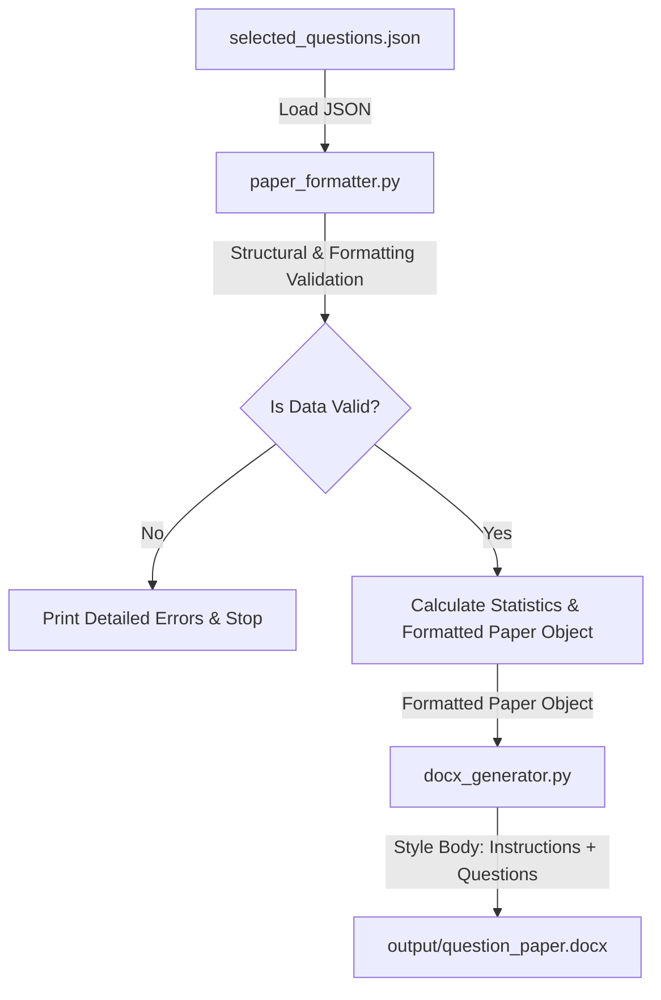

# Question Paper Formatter and DOCX Generator

This project is a completely independent Python application that takes selected exam questions (provided in a structured JSON file) and automatically transforms them into a formatted, high-quality, and professionally aligned Microsoft Word (`.docx`) question paper.

---

## Purpose of the Project

During examination design, the **Question Selection Engine** selects questions according to specific blueprints. This module receives those selected questions and handles formatting them into the **Government Polytechnic Nashik** examination paper body layout.

> [!IMPORTANT]
> The formatter intentionally does **NOT** generate the institutional examination header (institute name, logo, branch, semester, course code, duration, roll number, etc.). These headers are attached separately by the institute's examination cell during final printing. The generated paper starts directly with the **Instructions** section followed by the question sections.

---

## Folder Structure

```text
Question_Paper_Formatter/
│
├── main.py                          # Application entry point & coordination
├── paper_formatter.py               # Data parsing and structural validation logic
├── docx_generator.py                # MS Word document styling and writing logic
│
├── sample_data/
│   └── selected_questions.json      # Sample input database for testing
│
├── output/
│   ├── question_paper.docx          # Generated output Word document (main.py)
│   └── selected_questions_paper.docx # Test runner output (_run_test.py)
│
├── tests/
│   └── test_paper_formatter.py      # Automated test suite (15 unit tests)
│
├── requirements.txt                 # Project dependencies
└── README.md                        # Documentation
```

---

## Pipeline and Processing Flow



1. **Input**: Load and decode the JSON containing selected questions and optional instructions/titles.
2. **Validation & Normalization (`paper_formatter.py`)**:
   - Extract and validate `instructions` (if present).
   - Format section labels (e.g. `Q. 1`), section titles (faculty-provided, or dynamically derived fallback), and section attempted marks.
   - For each subquestion, preserve question text, marks, and Course Outcome (`course_outcome` / `co`).
3. **DOCX Generation (`docx_generator.py`)**:
   - Start with `Instructions:` heading and numbered items.
   - Render bold section headers with title and attempted marks: `Q. 1    Attempt any FIVE    (10)`.
   - Render subquestions in borderless 4-column layout: `CO`, label (`a)`, `b)`...), `question_text`, and marks `(2)`.
   - Ensure zero institutional header is generated.
4. **Output**: Write the file into `output/question_paper.docx`.

---

## Input Contract Schema

The application accepts a JSON file structured as follows:

```json
{
    "instructions": [
        "All Questions are compulsory.",
        "Illustrate your answers with neat sketches wherever necessary.",
        "Use of mathematical tables, steam tables, non-programmable electronic pocket calculator and Mollier's chart is permissible.",
        "Figures to the right indicate full marks. CO means Course Outcome.",
        "Assume suitable additional data if necessary.",
        "Communication instruments such as pager, mobile etc. are not allowed in the exam hall."
    ],
    "paper_information": {
        "branch": "Computer Technology",
        "semester": 4,
        "subject": "Operating System",
        "subject_code": "232145",
        "exam_type": "Final Examination",
        "paper_total_marks": 70
    },
    "sections": {
        "Q1": {
            "title": "Attempt any FIVE",
            "questions_to_attempt": 5,
            "questions": [
                {
                    "canonical_id": "CAN_001",
                    "question_text": "Define operating system.",
                    "unit": "Unit-I",
                    "marks": 2,
                    "rua": "R",
                    "difficulty": "Easy",
                    "course_outcome": "CO1"
                }
            ]
        }
    }
}
```

- **Sections & Questions are dynamic**: The formatter does not assume a fixed exam pattern or subject.
- **Section Titles**: Faculty-provided wording (e.g., `Attempt any FIVE`) is preserved verbatim. If omitted, a dynamic fallback is derived from `questions_to_attempt`.
- **Subquestion Labels**: Sequential lowercase alphabetic labels (`a)`, `b)`, `c)`, ...) are generated automatically based on question order.
- **Marks & CO**: Rendered dynamically from question data. Hidden fields (`canonical_id`, `unit`, `rua`, `difficulty`) remain accessible in memory.

---

## Setup & Installation

Ensure you have Python 3.8+ installed.

1. **Navigate to the project folder**:
   ```bash
   cd Question_Paper_Formatter
   ```

2. **Install dependencies**:
   ```bash
   pip install -r requirements.txt
   ```

---

## Running the Project

To execute the pipeline and generate the question paper:

```bash
python main.py
```

- This will run the program, validate the `selected_questions_sample.json`, display a summary of the exam on the console, auto-create the `output/` directory if missing, and output the styled Word document in `output/question_paper.docx`.

---

## Running Tests

To run the automated validation test suite:

```bash
python -m unittest tests/test_paper_formatter.py
```
